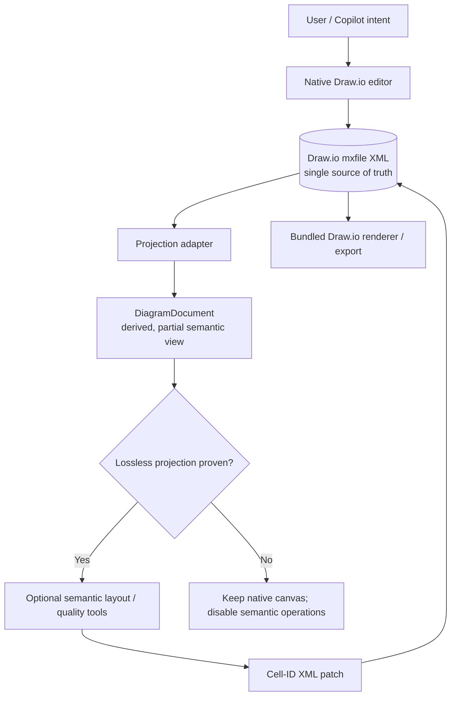
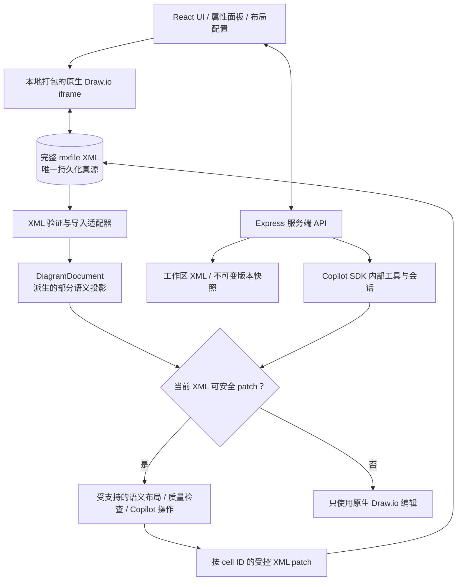
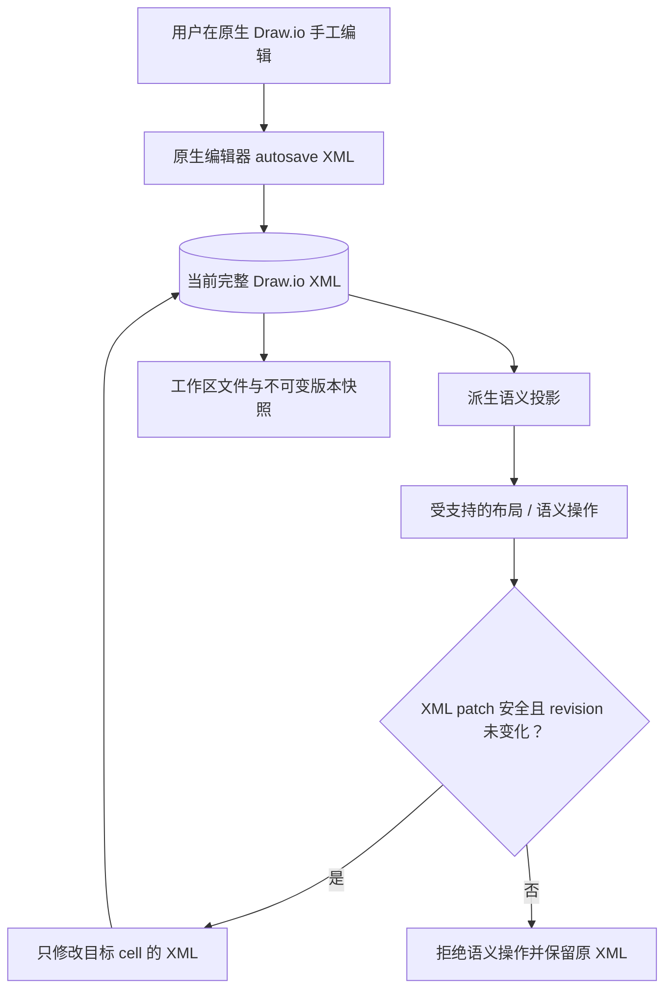
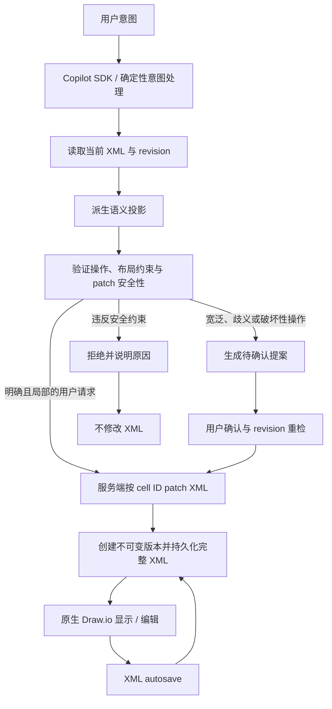

# Architecture Diagram Studio V2 架构设计

> **当前权威决策（ADR-0006 与 ADR-0008，2026-10-22）：完整 Draw.io `mxfile` XML 是所有图形的唯一真源，嵌入式原生 Draw.io 是唯一画布。本文中与 XML 真源决策冲突的旧表述由 ADR-0006 取代；关于 Studio/Freeform 双画布或 SVG 画布的旧设计由 ADR-0008 取代。`DiagramDocument` 仅是派生语义投影，不是第二个持久化真源。**

- 原始方案日期：2026-10-20；当前基线复核：2026-10-22
- 状态：当前架构参考；历史方案章节以 ADR-0006/0008 和 `v2/README.md` 为准
- 目标：在完整 Draw.io XML 单一真源和原生 Draw.io 唯一画布上提供受控语义布局、质量检查、配置与 Copilot 操作。本文不得把未实现的规划写成已交付能力。

## 1. V2 的核心判断

Draw.io 是通用编辑器和渲染器，不是自动布局引擎。布局与语义分析由独立算法完成，但最终交互和渲染统一回到原生 Draw.io。

推荐采用以 XML 为唯一真源、语义能力可选的分层结构：



最重要的一条原则：

> **Draw.io 原生 `mxfile` XML 同时负责数据真源、唯一画布渲染和通用编辑；应用在 XML 上提供可选的语义投影、布局、质量评估和受控 AI 操作。投影无法无损表达的内容必须留在 XML，不能被覆盖或丢弃。**

这样既可以得到 draw.io 的原生编辑/导出能力，又不会被 draw.io 默认的 C4、Sequence 或自动布局视觉风格绑架。

---

## 2. V2 要解决的产品问题

### 2.1 三种一级图形

V2 只把下面三类作为一级产品能力：

1. **C4**
   - Context
   - Container
   - Component
2. **Sequence**
3. **Flowchart / Process Flow**

C4、Sequence、Flowchart 是 Studio 优先提供语义工作流的三类图形，不是整个应用的格式边界。其它 Draw.io 图形必须仍可通过原生 XML 打开、编辑、保存与版本管理；无需先被 DiagramDocument 完整建模。

### 2.2 好看的定义

V2 的“好看”不能依赖模型随机发挥，也不能简单等于“使用某个主题颜色”。需要把视觉品味变成机器可执行的 Design System。

参考 `cathrynlavery/diagram-design` 的关键不是复制它的 SVG，而是借鉴它的设计方法：

- 少装饰
- 无意义的阴影全部删除
- 1px / hairline 风格边界
- 颜色用于表达语义，而不是给每个节点随机上色
- 一个画面只允许少量 accent
- 统一网格
- 统一间距
- 节点密度受控
- 标签长度、换行、留白和线条路径都属于设计的一部分
- 每个节点必须有存在理由

因此 V2 应定义自己的 `Studio Editorial` 视觉语言，而不是照搬 draw.io 默认主题。

参考：

- https://github.com/cathrynlavery/diagram-design
- https://github.com/cathrynlavery/diagram-design/blob/main/references/style-guide.md

---

# 3. 总体架构

## 3.1 当前运行架构



职责边界：

- 原生 Draw.io 负责通用图形编辑和渲染；没有第二张生产画布，也没有 Studio/Freeform 模式。
- 完整 `mxfile` XML 负责打开、自动保存、版本、恢复和导出。语义模型是临时派生投影，不能作为持久化或 diff 真源。
- ELK、Dagre、专用时序布局、路由和质量评估只服务于受支持的语义操作。它们不能覆盖未知 cell、页面、样式、嵌套结构或自定义属性。
- 服务端负责工作区范围、revision 检查、配置、版本快照和 Copilot 工具治理；浏览器负责原生编辑器交互、显示和预览。
- 主题只修改编辑器 chrome 与允许修改的图形背景，不得因 UI 主题重写用户单元格的 fill/stroke/font 样式。

## 3.2 为什么只保留原生 Draw.io 画布

第二个 SVG/React Flow 画布会创建两套选择、编辑、渲染和几何语义，且无法完整表示 Draw.io 的开放 XML 格式。因此生产界面只嵌入本地打包、固定版本的 Draw.io Web。布局算法是服务端/共享逻辑，不是另一套画布；预览也通过原生 Draw.io 显示。

# 4. DiagramDocument：派生语义投影

`DiagramDocument` 只为应用已支持的语义操作提供方便的视图。它不是 Draw.io XML 的完整表示，不得成为保存、版本、导出或工作区写入的权威数据。任何无法被该模型无损表示的 cell、parent 层级、page、style key、HTML 标签和自定义属性都必须保留在原始 XML 中。

## 4.1 当前语义投影结构

当前权威类型定义是 `v2/src/model/types.ts`。下面是与代码一致的精简结构；新增字段必须先更新该类型、运行时校验和相关测试。此投影不包含原生 XML 无法表达的完整信息，也不包含版本历史。

```ts
interface DiagramDocument {
  schemaVersion: 2;
  id: string;
  title: string;
  kind: "c4" | "flowchart" | "sequence";
  variant?: "context" | "container" | "component";
  theme: "studio-editorial";
  renderTheme?: "editorial" | "youth" | "warm" | "midnight";
  nodes: DiagramNode[];
  relations: DiagramRelation[];
  boundaries: DiagramBoundary[];
  layout: {
    profile: string;
    direction: "RIGHT" | "DOWN";
    routing: "orthogonal" | "polyline" | "curved";
    nodeSpacing: number;
    layerSpacing: number;
    boundaryPadding: number;
    externalSide: "LEFT" | "RIGHT";
    storageSide: "BOTTOM" | "RIGHT";
  };
  flow?: { primaryPath: string[] };
  sequence?: { participants: string[]; fragments?: SequenceFragment[] };
}
```

`workspace.json` 与版本文件持久化完整 Draw.io XML；语义投影在服务端从 XML 派生。

## 4.2 当前节点语义

当前节点类型使用 `name` 而非 `label`，并通过 `role`、`visualRole`、`layoutHints` 和 `visualStyle` 表达布局/样式语义。以下为当前字段的精简示意，完整类型以 `v2/src/model/types.ts` 为准：

```ts
interface DiagramNode {
  id: string;
  name: string;
  parentId?: string;
  description?: string;
  technology?: string;
  role: NodeRole;
  visualRole: VisualRole;
  x: number;
  y: number;
  width: number;
  height: number;
  layoutHints?: LayoutHints;
  visualStyle?: NodeVisualStyle;
}
```

例如，“把 external 放右边”应先识别 `role`，再由布局引擎结合关系和锁定约束计算位置，而不是对每个节点机械地增加固定的 x 坐标。该操作只有在完整 XML 可安全投影并 patch 时才可执行。

# 5. Design System：把 taste 写进代码

这是 V2 与当前版本最大的区别。

## 5.1 Design Token

建议建立：

```text
src/design/
  tokens.ts
  themes.ts
  diagram-grammar.ts
  typography.ts
  spacing.ts
  style-resolver.ts
```

### 基础 token

```ts
interface DiagramDesignTokens {
  grid: 4 | 8;

  spacing: {
    xs: number;
    sm: number;
    md: number;
    lg: number;
    xl: number;
    section: number;
  };

  node: {
    minWidth: number;
    maxWidth: number;
    minHeight: number;
    radius: number;
    borderWidth: number;
  };

  typography: {
    titleSize: number;
    nodeTitleSize: number;
    bodySize: number;
    edgeLabelSize: number;
    lineHeight: number;
  };

  edge: {
    width: number;
    dashedWidth: number;
    routing: 'orthogonal' | 'polyline' | 'curved';
    arrow: string;
    minSegment: number;
  };

  color: {
    canvas: string;
    ink: string;
    muted: string;
    border: string;
    accent: string;
    external: string;
    data: string;
    danger: string;
  };
}
```

## 5.2 不允许“彩虹节点”

默认策略：

- 80% 节点使用中性颜色。
- 10–20% 使用语义色。
- accent 默认最多突出 1–2 个关键节点/关系。
- external 不等于“红色”。
- database 不等于“绿色”。
- 每种图形类型使用自己的有限 palette。

## 5.3 C4 视觉语言

推荐不是 draw.io 默认 C4 模板，而是 editorial architecture：

```text
                    Customer
                       │
                       │ HTTPS
                       ▼
┌─────────────────────────────────────────────────┐
│ Order Platform                                  │
│                                                 │
│  ┌─────────────┐    ┌─────────────┐             │
│  │ Web App     │───▶│ Order API   │─────────┐   │
│  │ React       │    │ TypeScript  │         │   │
│  └─────────────┘    └──────┬──────┘         │   │
│                            │                │   │
│                            ▼                ▼   │
│                     ┌─────────────┐    Payment │
│                     │ PostgreSQL  │    Vendor  │
│                     └─────────────┘             │
└─────────────────────────────────────────────────┘
```

重点是：

- boundary 有明显但很轻的视觉层级。
- 内部节点不贴边。
- 数据流方向明确。
- external/vendor 有独立区域。
- 不让边从整个 boundary 中间穿过造成视觉噪音。

---

# 6. 三种 Diagram 的布局策略必须不同

不能再使用一个通用 `layout(document)` 解决所有问题。

## 6.1 C4：语义分层 + 左右数据流

C4 默认布局优先：

```text
LEFT → RIGHT

Actor / Source
      ↓
Entry / UI
      ↓
Domain / Business
      ↓
API / Worker
      ↓
Database / Storage

External / Vendor → 独立右侧 lane
Infra              → 与相关业务层平行
```

但不是机械地按 node type 排列，而是先建立 semantic rank：

```text
rank 0: actor / user / source
rank 1: ui / gateway / entry
rank 2: domain / business
rank 3: api / worker / integration
rank 4: data / storage
rank 5: infra
side: external / vendor
```

然后将真实关系作为约束修正 rank。

### C4 compound layout

ELK Layered 是主力，重点使用：

- compound nodes
- layered rank
- port constraints
- fixed order
- orthogonal/polyline routing
- group padding
- separate connected components

不要只调用 `elk.layout()` 然后接受结果；需要在 ELK 前后各有一层 Studio constraint。

```text
Semantic Graph
     ↓
Rank Assignment
     ↓
ELK Layered
     ↓
Studio Routing Repair
     ↓
Quality Score
     ↓
Accept / Repair / Retry
```

## 6.2 Flowchart：先决定主路径，再放分支

流程图最怕“蜘蛛网”。

默认：

```text
START
  │
  ▼
Step A
  │
  ▼
Decision ──────────┐
  │ yes             │ no
  ▼                 ▼
Step B            Step C
  │                 │
  └───────┬─────────┘
          ▼
        Finish
```

规则：

1. 先找 longest / primary path。
2. primary path 固定在视觉主轴。
3. decision 的 yes/no 分支尽量左右分开。
4. 分支在下游尽早 merge。
5. 不允许 edge 穿过 node。
6. 不允许 edge label 压在其它 edge 上。
7. 反向关系优先使用 routing lane，而不是穿越整个画布。

Flowchart 可以使用 ELK Layered，但要有自己的 edge ordering 和 decision routing。

## 6.3 Sequence：不要套 C4 layout

Sequence 图的核心不是二维 graph layout，而是：

```text
Participants → horizontal ordering
Messages     → strict vertical ordering
Activation   → vertical span
Fragment     → enclosing region
```

因此 sequence 使用专用布局器：

```text
participant order
       ↓
fixed x positions
       ↓
message timeline
       ↓
activation bars
       ↓
alt / opt / loop / par frames
       ↓
label collision repair
```

默认 participant order：

- actor/source
- UI/client
- API/domain
- service
- storage
- external/vendor

但 AI 可以指定 override。

---

# 7. Layout Profile：把“怎么排”变成可复用产品能力

不要让用户直接面对 ELK/Dagre 参数。

提供语义化 Profile：

```ts
type LayoutProfile =
  | 'architecture-flow'
  | 'architecture-layers'
  | 'architecture-compact'
  | 'architecture-wide'
  | 'process-main-path'
  | 'process-decision'
  | 'sequence-standard'
  | 'sequence-dense';
```

例如 `architecture-flow`：

```yaml
direction: RIGHT
primaryAxis: horizontal
externalPlacement: RIGHT
infraPlacement: PARALLEL
rankStrategy: semantic
edgeRouting: ORTHOGONAL
nodeSpacing: 48
layerSpacing: 96
boundaryPadding: 32
```

`architecture-layers`：

```yaml
direction: DOWN
layers:
  - actor
  - ui
  - domain
  - api
  - storage
externalPlacement: RIGHT
infraPlacement: PARALLEL
```

这样用户说“从上到下，用户在最上面，DB 最下面”时，AI 修改的是 profile/constraints，而不是坐标。

---

# 8. Routing：好不好看，50% 是线

V2 不应该只保存 `waypoints`，而应该有明确的 routing policy。

## 8.1 Edge routing policy

```ts
interface EdgeRoutingPolicy {
  mode: 'orthogonal' | 'polyline' | 'curved';
  avoidNodes: boolean;
  avoidEdges: boolean;
  preferSourceSide?: DiagramPortSide;
  preferTargetSide?: DiagramPortSide;
  lane?: string;
  minSegmentLength: number;
  crossingPenalty: number;
}
```

## 8.2 用户说“全部改成折线”时

不能：

```text
edge.style = polyline
```

然后结束。

正确流程：

```text
User intent
  ↓
set global routing.mode = polyline
  ↓
remove obsolete curved waypoints
  ↓
reroute all edges
  ↓
avoid nodes
  ↓
minimize crossings
  ↓
repair labels
  ↓
quality score
  ↓
commit
```

如果只改 style，不重新 route，极容易出现折线穿节点、交叉堆叠的问题。

---

# 9. Quality Engine：V2 的关键护栏

自动布局不能只返回 `DiagramDocument`，必须返回质量报告。

```ts
interface LayoutQualityReport {
  score: number;
  errors: QualityIssue[];
  warnings: QualityIssue[];
  metrics: {
    nodeOverlaps: number;
    edgeNodeIntersections: number;
    edgeCrossings: number;
    labelCollisions: number;
    disconnectedComponents: number;
    alignmentScore: number;
    whitespaceScore: number;
    densityScore: number;
  };
}
```

## 9.1 Hard constraints

以下情况直接失败：

- node-node overlap
- edge 穿过 node
- label 完全不可读
- sequence message 顺序错误
- boundary 包不住成员
- relation 指向不存在节点
- 节点超出画布边界

## 9.2 Soft score

```text
score =
  - 100 * edgeNodeIntersections
  - 80  * nodeOverlaps
  - 35  * edgeCrossings
  - 20  * labelCollisions
  + 10  * alignmentScore
  + 10  * whitespaceScore
  +  8  * directionalConsistency
  +  5  * semanticGrouping
```

权重不是永久 API，先用来建立 regression baseline。

## 9.3 Density

参考 Diagram Design 的“删除无意义元素”理念：

如果一个图超过合理密度，不应该继续缩小字体。

优先顺序：

1. 删除冗余 label。
2. 合并重复关系。
3. 合并过细节点。
4. 使用 boundary/group。
5. 增加画布空间。
6. 最后才降低字体。

---

# 10. Automatic Repair：布局失败后自动修复，而不是直接输出丑图

布局流程应为：

```text
                    ┌───────────────┐
                    │ semantic graph │
                    └───────┬───────┘
                            ▼
                    ┌───────────────┐
                    │ initial layout│
                    └───────┬───────┘
                            ▼
                    ┌───────────────┐
                    │ route edges   │
                    └───────┬───────┘
                            ▼
                    ┌───────────────┐
                    │ quality check │
                    └───────┬───────┘
                       pass │ fail
                            │
                            ▼
                    ┌───────────────┐
                    │ repair pass   │
                    └───────┬───────┘
                            ▼
                    ┌───────────────┐
                    │ score again   │
                    └───────┬───────┘
                            ▼
                     best valid result
```

最多 2–3 个 deterministic repair pass，不要让 AI 在每次 layout 后自由“凭感觉”改坐标。

Repair 优先级：

1. overlap repair
2. edge-node collision
3. edge crossing reduction
4. label collision
5. alignment
6. whitespace balance

---

# 11. AI 架构：AI 不直接改坐标

这是 V2 最重要的 AI 约束。

错误设计：

```text
AI → x/y/waypoint/style 字段 → 直接写 Document
```

正确设计：

```text
AI
 ↓
Intent / Operations
 ↓
Semantic mutation
 ↓
Constraint solver / Layout
 ↓
Quality engine
 ↓
Preview
 ↓
Commit
```

## 11.1 AI Tool 分类

### 创建

```text
create_diagram
```

输入：

- diagram type
- business description
- preferred layout profile
- theme

### 语义编辑

```text
add_node
remove_node
rename_node
connect_nodes
move_group
set_semantic_role
```

### 视觉编辑

```text
set_theme
set_node_style
set_edge_style
set_edge_routing
set_layout_profile
```

### 结构编辑

```text
create_boundary
move_to_boundary
change_layer
reorder_sequence_participants
```

### 全局智能操作

```text
apply_diagram_intent
```

例如：

> “把所有 external 放到右边，所有 DB 放最下面，保持主数据流从左到右。”

AI 应输出：

```json
{
  "intent": "reorganize_layout",
  "constraints": [
    {"role": "external", "placement": "RIGHT"},
    {"role": "storage", "placement": "BOTTOM"},
    {"flow": "primary", "direction": "RIGHT"}
  ]
}
```

然后 Layout Engine 执行。

---

# 12. AI 修改的 Preview / Commit 模型

借鉴 `next-ai-draw-io` 的思路：AI 操作不要直接不可逆地落到画布。

```text
AI stream
   ↓
temporary DiagramDocument
   ↓
validate
   ↓
layout
   ↓
quality check
   ↓
render preview
   ↓
user sees result
   ↓
commit one revision
```

如果 AI 输出一半、请求失败或用户 Stop：

```text
preview → discard
```

不能污染 undo history。

---

# 13. AI 的“智能程度”来自约束，不来自 prompt

Prompt 可以告诉模型设计原则，但不能承担几何正确性。

系统 prompt 应强调：

- 不直接修改 x/y。
- 不自行计算 edge waypoint，除非是局部精确操作。
- 优先修改语义和 layout intent。
- 全局视觉修改必须触发重新布局/route。
- 结果必须通过 quality check。
- 不通过就继续修复。

因此：

```text
LLM = 理解用户意图
Layout Engine = 计算几何
Quality Engine = 判断结果
Draw.io = 最终渲染
```

这四个职责不能混。

---

# 14. Draw.io 集成：本地打包，固定版本

## 14.1 推荐方式

采用 `next-ai-draw-io` 已验证的模式：

```text
draw.war
  ↓
version + SHA256 pinned
  ↓
extract selected web assets
  ↓
public/drawio/
  ↓
same-origin iframe
  ↓
DrawioAdapter
```

不要依赖：

```text
https://embed.diagrams.net
```

作为生产默认路径。

## 14.2 当前 Draw.io 集成

当前实现位于：

- `v2/src/components/DrawioFrame.tsx`：同源 iframe、embed 握手、原生选择监听、自动保存回调、主题 chrome/background 适配。
- `v2/src/model/drawio-xml-schema.ts`：Zod XML 契约，支持完整文件结构、压缩页解码与未知属性保留。
- `v2/src/model/drawio-xml-source.ts` 与 `v2/server/drawio-xml-source.ts`：检查语义投影是否可安全编辑，并按 cell identity patch 原始 XML。
- `v2/src/import/drawio.ts`：把可识别的原生 cell 投影到当前语义模型。
- `v2/src/export/drawio.ts`：用于应用创建新图及测试/fixture 的 XML 生成；不能用于重建覆盖用户已存在的完整原生文件。
- `v2/scripts/bundle-drawio.mjs`：下载/验证固定版本的 Draw.io Web 资源。

原生 Draw.io 内部 API 的访问集中在 `DrawioFrame`，并必须针对固定的 Draw.io 版本进行集成验证。属性面板通过原生选区和当前 XML 读取 cell 属性；所有编辑仍须经过原生编辑器模型或受控 XML 操作，并让自动保存更新完整 XML。

## 14.3 唯一权威数据流



不能以 `DiagramDocument` 重建已有文件；不能因打开文件、切换页面或切换 UI 主题而自动重排或重绘 cell 样式。XML 验证成功不代表语义编辑安全；安全门必须独立判断。

# 15. Draw.io Style Adapter：不要使用默认 C4 / Sequence 样式

新建图与明确请求的语义样式操作可由 Studio Style Resolver 生成 Draw.io 样式；已有原生文件的 cell 样式属于用户数据，打开文件、切换 UI 主题或普通保存时不得自动重写。

```ts
resolveNodeStyle({
  diagramKind,
  node,
  theme,
  density,
  state,
})

resolveEdgeStyle({
  relation,
  theme,
  routing,
})
```

输出 draw.io mxGraph style，仅用于新建图或明确请求的样式变更；不能作为已有文件的全量重绘策略。

## 15.1 C4

建议：

- 轻边框
- 低饱和 fill
- 小圆角
- label hierarchy
- technology 使用 secondary text
- description 使用 muted text
- boundary 使用低对比虚线/细实线
- external 使用轻微区别，不使用夸张颜色

## 15.2 Sequence

建议：

- participant header 简洁
- lifeline 使用 hairline dashed
- message label 使用较小字号
- activation bar 极窄
- fragment 使用低对比 frame
- call / return / async 使用统一箭头语言

## 15.3 Flowchart

建议：

- process：轻边框圆角矩形
- decision：克制的 diamond
- start/end：pill
- connector：统一折线
- yes/no 只保留必要 label
- 不给每个步骤加不同颜色

---

# 16. “External 全部放右边”的实现

这是一个典型的 V2 AI command，应当有确定性实现。

```text
User:
  把所有 external 放到右边

AI:
  semantic constraint:
    role=external → side=RIGHT

Layout:
  reserve right-side lane
  ↓
  place external nodes
  ↓
  layout internal graph
  ↓
  connect internal → external from RIGHT ports
  ↓
  route edges around internal graph
  ↓
  score
```

如果 external 数量太多导致右侧拥挤：

1. 增加 lane 高度。
2. 对 external 做 vertical packing。
3. 将关系集中到最接近 source 的侧面。
4. 必要时使用 edge bundling/lane。
5. 仍然失败才建议拆图。

绝不能简单把所有 external 的 x 坐标设置成同一个值。

---

# 17. “所有线变虚线 / curve → polyline”的实现

## 全局边样式

```text
set_edge_style
  ↓
update design token / relation style override
  ↓
rerender
```

如果只有视觉变化，不必重新布局。

## routing 变化

```text
curve → polyline
  ↓
clear incompatible bend points
  ↓
re-route
  ↓
quality check
```

这里必须区分：

- **style change**：不改变 geometry
- **routing change**：改变 geometry
- **layout change**：重新计算 node geometry

AI Tool 必须知道三者区别。

---

# 18. 手动调整与 AI 调整共存

用户拖动节点后，不应该马上被下一次 AI layout 覆盖。

每个节点增加：

```ts
layoutHints: {
  locked?: boolean;
  preferredRank?: number;
  preferredSide?: 'LEFT' | 'RIGHT' | 'TOP' | 'BOTTOM';
  preferredLane?: string;
}
```

例如用户手动拖动 `Payment Provider` 到右侧后：

```text
locked = true
```

AI 再执行“重新布局”：

- locked nodes 保持位置。
- 其它节点围绕 locked node 重排。
- 如果用户明确说“全部重新排”，才清除 lock。

这样 AI 不会和用户抢画布控制权。

---

# 19. AI 与手工编辑的并发保护

借鉴 `next-ai-draw-io` 的 stale-edit gate 思路。

每个 revision 保存：

```ts
revisionId
parentRevisionId
documentHash
createdBy: 'user' | 'ai' | 'layout'
```

AI 操作开始时记录：

```text
baseRevision = 42
```

如果用户期间手动编辑产生：

```text
revision 43
```

AI 不能直接覆盖 43。

必须：

```text
rebase operation onto 43
```

或者提示冲突。

---

# 20. Layout Engine 的 V2 结构

现有 `src/layout/layout.ts` 需要逐渐拆分。

建议：

```text
src/layout/
  core/
    graph.ts
    constraints.ts
    ranks.ts
    geometry.ts

  c4/
    c4-layout.ts
    c4-rank.ts
    c4-boundary.ts
    c4-routing.ts

  flow/
    flow-layout.ts
    flow-main-path.ts
    flow-decision.ts
    flow-routing.ts

  sequence/
    sequence-layout.ts
    sequence-fragments.ts
    sequence-routing.ts

  engines/
    elk.ts
    dagre.ts
    d3.ts

  quality/
    quality-score.ts
    overlap.ts
    crossings.ts
    labels.ts
    density.ts

  repair/
    repair-overlap.ts
    repair-crossing.ts
    repair-labels.ts
```

现有 ELK/Dagre/D3 不需要立即删除；它们变成底层 engine，而不是产品层 API。

---

# 21. 跨布局引擎共享的 Layout Contract

ELK、Dagre 和时序专用布局可以采用不同算法，但必须共享可验证的布局约束：

1. 避免节点重叠和连线穿过无关节点。
2. 保持布局方向、语义分层和边界成员关系。
3. 评估交叉、标签可读性、间距和画布越界。
4. 尊重锁定节点和明确的用户布局约束。
5. 相同输入和配置应尽可能产生确定性结果。
6. 对不支持的图形结构拒绝语义重排，不影响原生 Draw.io 编辑。

这些是算法契约，不依赖 React Flow 或任何第二渲染器。

# 22. Layout Determinism

同一个 Document + 同一个 Profile 必须尽量产生同一个 layout。

保存：

```ts
layoutProfile
layoutVersion
randomSeed
engineVersion
```

例如：

```json
{
  "profile": "architecture-flow",
  "engine": "elk",
  "engineVersion": "0.x",
  "layoutVersion": 2,
  "seed": 1
}
```

AI 每次重新生成不应该导致节点随机漂移。

---

# 23. “漂亮”必须进入测试

新增视觉 regression fixtures：

```text
tests/diagrams/
  c4/
    small.json
    ecommerce.json
    enterprise.json
    external-heavy.json

  flow/
    simple.json
    decision.json
    branching.json

  sequence/
    simple.json
    auth-refresh.json
    payment.json
```

每个 fixture：

```text
Document
 → layout
 → quality report
 → draw.io render
 → SVG/PNG snapshot
```

测试至少检查：

- 0 overlaps
- 0 edge-node intersections
- crossing 数量 <= threshold
- labels readable
- expected direction
- external placement
- boundary containment
- snapshot diff

真正达到 V2 目标之前，必须有一批人工认可的 golden diagrams。

---

# 24. Golden Diagram / Taste Corpus

这是实现“像 designer 做的”最重要的长期资产。

建立：

```text
tests/golden/
  c4/
  flow/
  sequence/
```

每张 golden diagram 保存：

- semantic source
- expected layout profile
- theme
- expected draw.io XML
- expected SVG/PNG
- quality metrics
- 人工评分

AI、layout engine、style resolver 每次升级都跑这套 corpus。

如果新算法虽然数学上更优，但视觉评分下降，就不能直接上线。

---

# 25. AI Prompt / Design Guide

AI 不应该知道几百个 draw.io style 字符串。

应该给 AI 一个高层 Design Guide：

```text
Architecture:
- use semantic layers
- primary flow left → right
- external/vendor on right
- storage low in the composition
- keep internal boundaries spacious
- avoid edge crossings
- use one accent for emphasis

Flow:
- preserve one primary path
- branches should diverge clearly
- merge quickly
- decision labels stay near branch origin

Sequence:
- actor/client first
- infrastructure/storage last
- keep message labels short
- avoid unnecessary fragments
```

然后由代码把这些规则转换成 constraints。

---

# 26. Internal Copilot SDK Tool API V2

Diagram intelligence is implemented as internal Studio capabilities registered through the local GitHub Copilot SDK. It is not exposed through a standalone MCP server or an external MCP tool surface.

Internal tools provide design references, active-diagram inspection, authoritative quality evaluation, workspace-example retrieval, revision-bound edit proposals, built-in template previews, version listing, semantic diffs and restore proposals. Tool handlers call shared domain services rather than reimplementing layout, quality or validation.

Proposal tools are non-persistent and bound to the current native XML revision. Broad redesigns, ambiguous edits, bulk-destructive operations, template replacement and version restore require an explicit proposal and user confirmation. A focused change explicitly requested by the user may be applied directly after inspecting the active document and exact revision. Every workspace-backed server mutation is revalidated server-side and creates an immutable version snapshot; standalone local-file edits use the native autosave/export path and do not create workspace history. Semantic layout-quality gates apply only when the operation uses semantic layout.

Supported tool outputs and context are bounded. Retrieved project contents are untrusted evidence, not instructions. Mermaid import/conversion remains outside the V2 scope.

# 27. Draw.io 与 AI 的实际交互闭环



Copilot 不能直接编写任意 XML 或项目文件。内部工具共享服务端领域逻辑；直接应用也必须经过 revision 检查、操作校验和版本创建。宽泛、破坏性或有歧义的修改必须走可审查提案。

# 28. 当前代码与架构职责映射

| 领域 | 当前实现与约束 |
|---|---|
| 权威文档 | 完整 Draw.io `mxfile` XML；`DiagramDocument` 是派生的部分语义投影 |
| 画布与通用编辑 | 固定版本、本地打包的原生 Draw.io Web；无第二画布 |
| XML schema | `v2/src/model/drawio-xml-schema.ts`，Zod 校验；未知属性与扩展元素保持开放 |
| 安全语义修改 | `drawio-xml-source.ts` 中的投影安全门与 cell-ID XML patch |
| 布局 | ELK、Dagre 与专用时序布局；只对当前可安全投影的结构启用 |
| 质量评估 | 共享的服务端/布局质量逻辑；仍可供内部 Agent 和预览使用，不是右侧独立 Quality 页面 |
| 主题 | 应用 CSS token 适配编辑器 chrome 与图形背景；不得自动改写用户 cell 样式 |
| Copilot | GitHub Copilot SDK 的内部服务端工具；不提供独立 MCP 服务或 VS Code MCP 配置 |
| 持久化与版本 | 工作区保存完整 XML，revision 基于权威 XML，版本快照保留原生文件 |
| 配置 | 服务端版本化的布局 allowlist、提示词、模型与 reasoning effort |
| 导入/导出 | 导入保留完整 XML；新图可由语义模型生成 XML；不能用派生投影重建已有原生文件 |

历史提案中关于 React Flow、D3 布局实验、双画布、DiagramDocument revisions 或独立 DrawioAdapter 模块的描述均不构成当前实现要求。

# 29. 原始分阶段计划（历史记录）

以下阶段保留了 2026-10-20 的原始规划，用于追踪设计意图；它们不是当前待办列表，也不能证明相应功能已经实现。当前能力以 `v2/README.md`、源代码和 CI 为准。任何与 ADR-0006/0008 冲突的阶段描述都由当前 ADR 覆盖。

实施与验证应优先覆盖：

1. XML 无损打开、编辑、保存、恢复和多页/未知元素保留。
2. 原生选区与属性检查器、可编辑属性和保存往返。
3. revision 检查、服务端操作白名单和不可变版本快照。
4. ELK/Dagre/时序布局、路由和质量评估回归。
5. 固定 Draw.io 版本的同源 iframe 集成验证。
6. Copilot 提案/直接应用边界、配置版本与 Agent 轨迹。

这些验收项必须由测试或实际运行证据证明，不能仅凭规划文档标记完成。

# 30. 当前技术选型

| 领域 | 当前基线 |
|---|---|
| 权威文档 | 完整原生 Draw.io XML |
| 语义视图 | 派生、部分的 `DiagramDocument`，不作为持久化真源 |
| C4 / Flow 布局 | ELK Layered、Mr. Tree、Radial、Stress、Force 与 Dagre Layered；算法可选项受服务端配置 allowlist 约束 |
| Sequence 布局 | 专用时序布局与路由 |
| 渲染与手工编辑 | 本地固定版本的 Draw.io Web |
| Draw.io 集成 | 同源 iframe 与受控桥接 |
| 主题 | 应用 CSS token；只适配编辑器 chrome 与图形背景 |
| AI | 意图 → 服务端校验 → revision 检查 → 安全 XML patch / 待确认提案 |
| 持久化 | 工作区与版本快照存完整 XML；revision 由 XML 决定 |
| 离线 | Draw.io Web 资源构建时固定版本并本地打包；Copilot 可用性取决于登录和运行环境 |
| 回归 | XML schema/patch、布局质量、主题保真、服务端持久化与固定版本编辑器集成测试 |

# 31. 最重要的设计决策

## 决策 1：不要追求“draw.io 默认长什么样”

draw.io 是 renderer，不是 design system。

## 决策 2：不要让 AI 直接画坐标

AI 表达 intent；layout engine 负责 geometry。

## 决策 3：不要把一个通用 layout 算法用于三种图

C4、Flow、Sequence 是三种不同的视觉语法。

## 决策 4：不要把“布局成功”定义为算法没有报错

必须经过 quality engine。

## 决策 5：Draw.io XML 是唯一的文档真源

完整的 `mxfile` XML 才是唯一持久化源。React / Studio 使用的 `DiagramDocument` 只是派生的局部语义视图；任何语义修改必须通过受控 cell-ID patch 写回 XML，绝不能用投影重建整份文档。

## 决策 6：不要用公网 Embed 作为生产默认

固定版本、本地打包、同源 iframe 是 V2 默认路径。

## 决策 7：不要复制 Diagram Design 的具体视觉资产

借鉴其“把 taste 写成规则”的方法，建立 Studio 自己的 editorial design system。

---

# 32. V2 成功标准

V2 不以“支持更多图形”作为成功标准，而以以下结果作为成功标准：

### C4

> 输入一个中等复杂度企业架构，默认生成的图已经接近可以放进 architecture review 文档，不需要用户先手工整理一遍。

### Flowchart

> 主路径一眼可读，分支清晰，线不穿节点，不出现蜘蛛网。

### Sequence

> participant、message、activation、fragment 层次清楚，读者能沿时间轴自然阅读。

### AI

> 用户说“把 external 放右边”时，系统重新理解布局，而不是把所有节点机械地移动到右边。

### 手工编辑

> 用户拖过的节点可以锁定；AI 重排时不会破坏用户意图。

### Draw.io

> 用户最终看到的是原生 draw.io canvas，并且导出的 `.drawio` 可以继续在标准 draw.io 中编辑。

### Offline

> draw.io Web renderer 不依赖公共在线 Embed；资源随应用固定版本发布。AI 模型是否离线是独立部署问题。

### Visual quality

> 每个版本都有 golden diagrams 和 SVG/PNG regression，不允许“功能正确但视觉退化”悄悄进入 main。

---

# 33. 一句话架构

**V2 = Draw.io XML 单一真源 + 原生 Draw.io 唯一画布 + 派生语义投影 + 受控布局/质量能力 + 服务端 Copilot 与版本化持久化。**

其中最关键的产品差异不是“用了 draw.io”，而是：

> **Draw.io XML 保存完整原生文档；原生 Draw.io 负责通用编辑；应用只在安全投影范围内提供语义布局、质量评估和受控 AI 操作，且绝不以派生模型覆盖原始 XML。**
