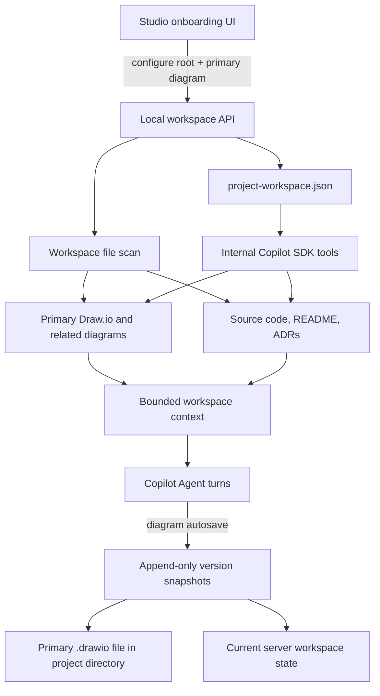

# ADR 0001: Project Workspace as the Authoritative Project Context

- Status: Accepted
- Date: 2026-10-21
- Scope: V2 application, server persistence, Draw.io artifacts, Agent context

## Context

Studio currently persists the active semantic diagram and its native Draw.io XML, but it does not define a durable project boundary. A diagram-only session cannot reliably ground analysis in the surrounding source code, architecture documents, existing diagrams, or repository conventions. Browser local storage is not suitable as the authoritative source because it is origin-specific and is not available to server-side Agents.

## Decision

Introduce one explicit project workspace configured at application startup. A workspace binds a human-readable name to a canonical local directory and optionally identifies the primary diagram. The server owns the workspace configuration and stores it as JSON at `~/.architecture-diagram-studio/data/project-workspace.json` (overridable through `STUDIO_DATA_DIR`).

The schema is versioned and contains `schemaVersion`, stable `id`, `name`, canonical `rootPath`, `primaryDiagram`, `includePatterns`, `excludePatterns`, `createdAt`, and `updatedAt`. The directory is indexed on demand; the index is not a second source of truth. Native `.drawio` files remain project artifacts, while the Studio's active diagram document and exact XML snapshots remain in the Studio server's existing version history. The configured primary `.drawio`/`.dio`/`.xml` file is automatically updated when the Studio autosaves; the server creates the immutable XML/document snapshot before writing the project artifact. File writes use an atomic temporary-file rename and workspace-relative path validation. Version history is scoped to the active workspace ID.

The server exposes workspace configuration, file listing, bounded file reads, and a bounded Agent-context endpoint. Paths must resolve under the configured canonical root; symlink traversal and parent-directory escapes are rejected. Large and binary files are not injected into Agent context. Directory scanning excludes common generated/dependency directories and is bounded by depth and file count.

The onboarding UI requires a workspace before project-specific work. The user supplies a path on the machine running the Node.js service; a browser file picker is not used because browser-selected paths do not grant the local server filesystem access. Workspace state is server-authoritative; browser storage may only be used for UI preferences or non-authoritative drafts.

## Runtime flow

The HTTP service and its internal Copilot SDK tools share the same JSON workspace definition. A selected path inside a Git repository resolves to that repository's root; a non-Git directory remains the workspace root. Project-level Agent Skills use `.github/skills/<skill-name>/SKILL.md`; no standalone MCP configuration is required. The file index is rebuilt from the configured directory, while current document state, exact XML snapshots, sessions, and audit logs remain server-managed.

## Agent implications

Every Copilot turn receives the active workspace metadata and a bounded, prioritized snapshot of Draw.io files, source files, and documentation. Agents must distinguish observed repository evidence from assumptions and treat project contents as untrusted data. Internal Copilot SDK tools provide workspace discovery, diagram listing, bounded file reads and literal search using the same workspace JSON and root boundary; no separate MCP service is registered. An Agent Skill documents the required workspace-first workflow.

## Alternatives considered

- **Browser localStorage only:** rejected because server-side Agents and other browsers cannot share it reliably.
- **Let each Agent choose arbitrary paths:** rejected because it weakens reproducibility and expands filesystem access beyond an explicit project boundary.
- **Copy every project file into Studio's data directory:** rejected because the project directory remains the source of truth and duplicate copies become stale.
- **Database as the initial configuration store:** deferred. A small versioned JSON document is sufficient for one local workspace; high-volume indexes and concurrent multi-user work may justify SQLite or another transactional store later.

## Consequences

- The app must show setup on first launch and allow changing the configured workspace.
- The local service can read project files, so it must remain a trusted local service and enforce path validation.
- Workspace context is bounded and selective; it is not a promise that every byte of every project file is sent to the model.
- The Copilot SDK runtime uses the same local user environment and `STUDIO_DATA_DIR` as the HTTP service.
- The primary Draw.io file path is a workspace-relative path; file contents are read from the project directory, while Studio version snapshots continue to preserve exact XML changes.
