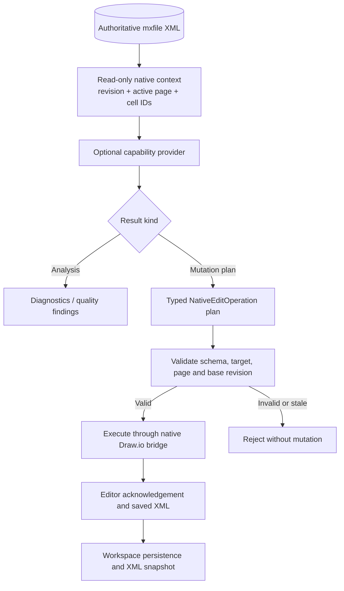

# ADR-0012: Native Diagram Extension Contracts Without a Parallel Model

- Status: Accepted
- Date: 2026-10-23
- Related: [ADR-0011 — Native Draw.io Is the Only Diagram Model](./0011-native-drawio-only-model.md), [ADR-0009 — Centralized Draw.io XML Processing](./0009-centralized-drawio-xml-processing.md), [ADR-0010 — Unified Server-Side Copilot Intent Processing](./0010-unified-server-side-copilot-intent-processing.md)

## Context

ADR-0011 correctly removed the incomplete `DiagramDocument` model, the secondary SVG canvas, and the semantic layout/quality pipeline that operated on that model. This avoids duplicating the native Draw.io model and prevents unsupported cells or metadata from being lost.

The removal must not imply that geometry analysis, layout, style generation, quality checks, shape inspection, or richer native editing are permanently out of scope. Existing research documents (including `docs/drawio-shape-support-analysis.md`, `docs/diagram-design-implementation-plan.md`, and `docs/diagram-design-style-report.md`) contain useful design principles, but their old implementations and file references must not be copied directly into V2.

The missing piece is an explicit extension seam: future capabilities should be able to analyze the current native document and propose narrowly scoped operations without creating another authoritative graph model.

## Decision

Keep the native Draw.io XML and editor as the only document model and canvas. Add shared TypeScript contracts for future capabilities in `v2/src/model/native-diagram-capabilities.ts`. These are extension interfaces only; they do not install a registry, enable new UI features, or claim that layout/quality providers already exist.

### Contract boundaries

1. **Input context is native and revision-bound.** A capability receives the authoritative XML snapshot, its server-issued revision, active page ID, selected cell ID, and the lightweight native-cell target index. This context is transient and read-only, not a persisted graph model.
2. **Mutation capabilities target the native editor.** Focused edits may use shared typed operations. Complex layout/style/structural edits can use one revision-bound `run_drawio_script` command against the actual Draw.io Graph/Model API. Scripts must not return replacement XML, write files, or create a parallel graph model.
3. **Analysis capabilities return findings only.** Quality, contrast, geometry and routing analyzers return native page/cell IDs and diagnostics. A finding does not itself block ordinary native editing or saving. A separately approved operation may define its own validation policy.
4. **Execution remains centralized.** Server revision checks, the native editor bridge, acknowledgement handling, XML save path and versioning remain the execution boundary. The generic script operation lets AI use new native editor capabilities without adding each one to the shared operation union/schema. Script mutations are wrapped in a model update and active-page cells are snapshotted for rollback on script errors.
5. **No implicit semantic model.** Providers may use the shared XML DOM/schema utilities and derive temporary facts needed for one operation. They must not persist nodes/edges as a substitute for mxCells, assign a closed Studio-specific shape taxonomy to the document, or serialize a derived representation over the original XML.
6. **Capability availability is explicit.** A descriptor or future registry entry is not proof of an implemented capability. Only registered providers with concrete handlers, validation and tests may be exposed to the UI or Copilot.
7. **Keep the native editor as the renderer.** Styling or layout operations change explicitly targeted native cell properties through the typed operation bridge. UI theme changes remain presentation-only and must not rewrite cell styles implicitly.

## Intended extension flow

## How to reuse prior research

- **Layout, shape, grouping, routing, endpoint and other native editing tasks** can use `run_drawio_script` when supported by the current Draw.io runtime. Scripts operate on real `mxCell` objects; they must not rebuild a complete graph document.
- **Quality and accessibility rules** belong in a read-only analysis provider that returns rule IDs, severity, page/cell IDs and evidence. Warnings are diagnostics unless a specific user-requested operation has an explicit validation policy.
- **Style tokens and style resolution** may help construct explicit `set_style` or future typed style operations. They must not be applied merely because the UI theme changes.
- **Shape and XML compatibility research** remains relevant to the shared schema and property inspector. Unknown stencils, wrapper elements and custom attributes remain legal native content; no closed shape registry is required for opening or basic editing.
- **Old SVG/React Flow implementation details, semantic layouts and `DiagramDocument` examples** are historical reference only. Do not port them directly into active V2.

## Consequences

- V2 remains small today while retaining a stable contract for future native operations and analysis.
- The current runtime has no generic capability registry and no custom layout/quality engine. This ADR defines the seam, not those implementations.
- Future capability work should not add an operation for every UI action. Use the generic script runtime, then add tests for shared helpers or concrete editor/API failure cases. Keep coverage for stale revisions, script exceptions, active-page rollback, and XML/persistence acknowledgement.
