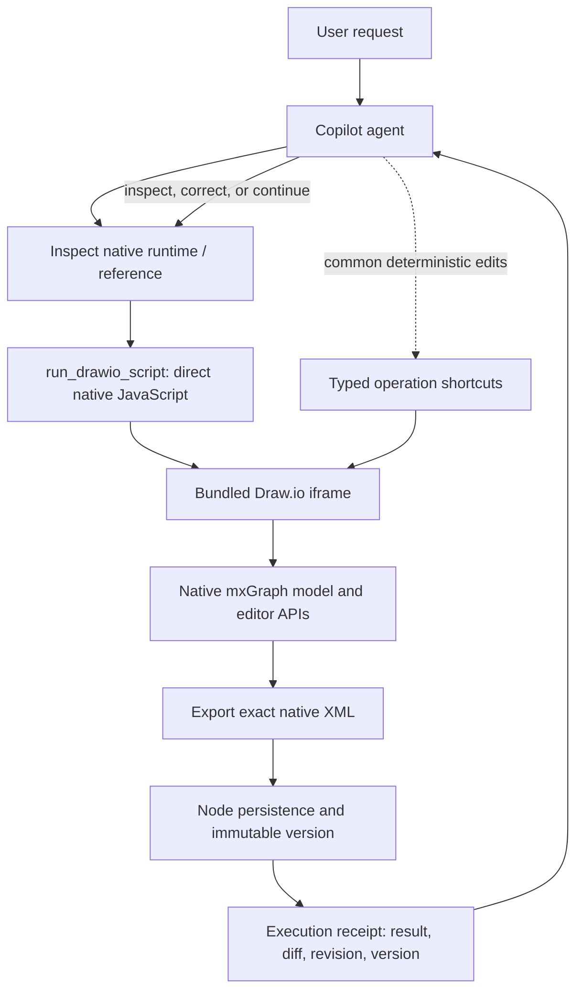

# ADR-0018: AI-First Native Draw.io Execution

- **Status:** Accepted; initial AI-first runtime changes implemented in this branch
- **Date:** 2026-10-24
- **Scope:** V2 local, single-user Architecture Diagram Studio
- **Supersedes:** The restrictive interpretation of the script path in the Native Copilot Capability Audit and V2 README. This ADR does not introduce a second diagram model.

## Decision in one sentence

Treat the bundled Draw.io runtime as the primary execution environment for diagram work: give the agent broad, direct access to its native JavaScript APIs, let the agent execute and iterate without a confirmation gate, and use native XML snapshots, version history, execution traces, and recovery to handle mistakes rather than limiting capability through an operation allowlist.

## User and operating assumptions

This is a local single-user workbench, not a multi-tenant service. The owner explicitly prefers completion and agent autonomy over security boundaries designed for untrusted users or shared deployments. The owner accepts that an AI-generated edit can be incorrect and uses document versioning and source control to recover.

The permission domain of this decision is **the Draw.io editor/runtime used for diagram work**. It does not imply that the product should silently add arbitrary Node.js shell or host-filesystem execution. File browsing, opening, saving, versioning, and exporting remain explicit host-service capabilities; the agent can use the editor's native APIs to change the diagram and the existing persistence path to save it.

The product should not add multi-user authorization layers, per-operation approval bureaucracy, AST allowlists, or a new typed operation for every Draw.io feature merely to restrict what the agent can do. Operational recovery remains valuable, but it must not be presented as a security sandbox.

## Why the current direction is insufficient

The existing implementation has a typed `NativeEditOperation` vocabulary for common edits and a script path for more complex actions. The capability audit already recognizes that general scripts avoid implementing a separate server/client/schema path for every new capability. However, treating the script path as a narrowly allowlisted exception retains the original limitation: the agent has to learn a partial Studio-specific interface instead of using Draw.io itself.

Draw.io already owns native cells, geometry, styles, connectors, layers, groups, pages, the undo model, rendering and XML serialization. The agent should be able to use those capabilities directly. An unfamiliar operation should trigger runtime inspection, reference lookup, a script attempt and error-driven correction—not an automatic dead end because no Studio operation has been registered for it.

## Target architecture

The native Draw.io `mxfile` XML remains the sole saved diagram model. No `DiagramDocument`, shadow graph, custom renderer, or model-to-XML reconstruction is introduced.

## 1. Make script execution a first-class agent tool

Introduce a dedicated `run_drawio_script` Copilot tool instead of hiding arbitrary scripts inside `propose_native_edits` as one branch of a typed-edit tool.

The tool accepts the JavaScript source to execute and optional human-readable intent metadata. It must not require the script to be converted into `NativeEditOperation[]`. The agent may write a script for any operation supported by the loaded Draw.io runtime, including APIs not explicitly listed in Studio's typed contract.

The script runs in the live Draw.io editor context and can use the native editor objects, including:

- `ui` and `editor` for editor state and editor-level commands.
- `graph` for graph operations such as selection, cell creation, connection, grouping, alignment, layout-related changes and refresh.
- `model` (the live mxGraph model) for cell, parent, terminal, geometry, value and style mutations.
- `graph.view` for rendered state and geometry inspection.
- The runtime's available mxGraph/mxUtils/mxGeometry and shape/stencil facilities, discovered from the actual bundled runtime rather than a hard-coded claim that a feature is unavailable.
- Ordinary JavaScript access within the editor frame, subject to the browser runtime. This broad execution context is intentional for this local tool; it is not a sandbox.

The named parameters are convenience bindings, not a security boundary. Do not add an AST parser that rejects calls merely because they are not on an allowlist. Do not require a capability manifest to approve each method before execution. Runtime inspection can inform the model, but a missing or incomplete manifest must not block a script.

If a feature has no known recipe, the agent can inspect the live objects and prototype methods, consult the Draw.io reference/skill, attempt the relevant native API, read the exception or postcondition failure, and try again.

## 2. Keep typed operations as shortcuts, not as permission boundaries

Retain `NativeEditOperation` for common, deterministic edits such as select, rename, color change, move, resize, simple insertion, C4 conversion, and the Studio-owned Dagre/ELK layout path. These operations are useful because their intent and result are easy to validate.

They must not define the ceiling of agent capability. The agent can choose direct script execution whenever the typed vocabulary is too narrow, cumbersome, or unable to preserve the user's intent. Do not create a new operation type, Zod schema branch, tool schema branch and bridge implementation for every new graph capability.

Specific implications:

- Independent edge creation, reconnection, waypoints and routing can be performed directly through native APIs.
- Shape/stencil choice and arbitrary style keys do not require a new fixed operation type.
- Grouping, reparenting, align/distribute, layer visibility, collapse/expand, page-level tasks and other native features can be executed through the runtime.
- C4, layout and other high-value workflows may keep dedicated typed/planner paths when those paths produce a more reliable result, but the script path always remains available.

## 3. Use runtime discovery and references to improve execution quality

The agent needs useful knowledge, not an artificial permission ceiling. Provide a concise Draw.io native-runtime skill/reference with:

- The distinction between `ui`, `editor`, `graph`, `graph.view` and `model`.
- Version-pinned API notes for the bundled Draw.io release.
- Working recipes for adding vertices and edges, reconnecting edges, setting geometry and waypoints, styling, choosing shapes/stencils, groups, layers, pages, and custom shape behavior.
- Common API mistakes and correction patterns—for example, `graph.getDefaultParent()` is a graph method; do not assume it exists on `model`.
- Examples that show the correct `beginUpdate()` / `endUpdate()` pairing and how to inspect the resulting live cell and rendered state.
- A small list of tested recipes, while making clear that recipes are examples rather than an exhaustive list of permitted actions.

Keep `inspectRuntime` and capability-manifest data as diagnostic evidence. They should describe what was observed, with the Draw.io version and inspection limits, not claim that an unlisted capability does not exist. Avoid flooding every model turn with the entire mxGraph API; provide a focused summary and let the agent request deeper inspection when needed.

## 4. Remove confirmation as the default execution gate

For this local single-user mode, a script emitted as the tool call for the user's current request executes immediately. Do not require a second click solely because the script is arbitrary JavaScript, changes multiple cells, deletes cells, changes routing, or performs an operation absent from the typed schema. Do not require a proposal/confirmation round-trip for normal script execution.

The UI may offer an optional pause/review setting for debugging, but it is off by default. Confirmation is a user-experience choice, not the main control used to bound agent capability.

The agent is expected to verify the outcome after execution. When the result is wrong, it should inspect the actual diagram, correct it or restore a version, and continue. If the agent's requested action is ambiguous, it can still ask the user a semantic question; that is about intent, not permission.

## 5. Execution lifecycle: execute, inspect, save, continue

Every script call should follow one consistent lifecycle:

1. Capture the exact current native XML, active page, selection and current revision/version as the pre-execution checkpoint.
2. Execute the submitted source against the live Draw.io runtime with the current `ui`, `editor`, `graph` and `model` bindings.
3. Capture the script's returned JSON-compatible value, thrown error and stack (when available), elapsed time and any editor events.
4. Export the actual native XML from Draw.io. Do not infer success merely because the JavaScript returned or a model method did not throw.
5. Compare the before/after XML using a native-cell-aware diff and report a compact summary: changed pages, added/removed/changed cell IDs, relevant labels and connector changes when these can be derived reliably.
6. Save through the existing Node persistence path, create/retain an immutable version, and await the normal save acknowledgement.
7. Return a structured execution receipt to the agent with status, script result, error details, before/after revisions, version ID and diff summary.
8. Let the agent inspect the new state and issue another script in the same task when needed.

A script can mutate the graph and then throw. Do not claim that an exception means no changes occurred. Preserve and report the actual state; do not silently discard partial work by default. The pre-execution version provides the recovery point, and the agent may repair the current graph or explicitly restore that version. If a reload is necessary to recover a hung editor, reload from the latest known-good persisted XML and report that recovery clearly.

The saved artifact remains native Draw.io XML. Persistence must not convert it to a reduced custom model.

## 6. Keep full execution evidence locally

The local trace for every script call should include, subject to practical size limits:

- Original script source and the agent's short intent summary.
- Draw.io/bridge version, active page, selected cell IDs, input revision and pre-execution version.
- Execution start/end, returned value or exception/stack.
- Before/after revision, derived diff, save status and resulting version ID.
- Whether execution was retried, repaired, or recovered by reloading the editor.

This is for debugging, replay and understanding changes—not a regulatory audit claim. The trace should preserve enough source to reproduce the failure. The chat response can remain concise; script source should be accessible in the trace/details view.

## 7. Handle hangs as an operational failure, not a permissions problem

Executing arbitrary JavaScript on the editor's main thread cannot be safely interrupted by a timer running on that same thread. Do not claim that a Promise timeout or a post-execution timer can terminate a synchronous infinite loop.

The host page is outside the Draw.io iframe's JavaScript event loop, so use a host-side watchdog to notice a missing execution acknowledgement. If execution does not return within the configured budget, the host can offer or perform a controlled iframe reload from the last persisted XML checkpoint. This is a recovery mechanism, not a sandbox. Make the default budget configurable and report when the editor had to be restarted.

Do not add a cross-origin sandbox or remove APIs merely to make the script tool appear safer; that conflicts with the explicit local single-user objective.

## 8. API and tool contracts

The target Copilot surface should remain small:

| Tool | Purpose | Role |
| --- | --- | --- |
| `run_drawio_script` | Execute JavaScript against the live native Draw.io runtime and return a receipt | Primary full-capability editing tool |
| `inspect_drawio_runtime` (or the existing equivalent) | Inspect active page, selection, cells, runtime version/methods and relevant rendered state | Discovery and verification |
| `select_diagram_element` | Focus an existing native cell | Convenience |
| `search_drawio_shapes` / `search_drawio_elements` | Search curated shape/cell references | Discovery hints, not exhaustive proof |
| `get_drawio_reference` | Return targeted API guidance and known-good recipes | Context on demand |
| Typed operation path | Execute common, validated edits and specialized planners | Optional fast path, never a prerequisite |

Do not expose an independent tool for every verb such as create-edge, bend-edge, group-cells, or change-layer. These are runtime capabilities that the script tool can express. Dedicated helpers are justified only when they measurably improve a frequently used workflow's result quality or reduce repeated reasoning—not because a raw capability is forbidden.

## Implementation plan

The initial implementation is included in this branch. The direct script tool, manifest/AST gate removal, default confirmation removal, serialized XML acknowledgement changes, local script trace, and iframe watchdog are in place. The remaining plan items below identify validation and follow-up hardening rather than a second design phase.

1. Completed in this branch: add the standalone `run_drawio_script` Copilot tool while keeping the typed-edit schema limited to typed operations.
2. Completed in this branch: remove AST/script-policy and runtime-manifest permission gates; disable default confirmation gates for scripts, deletes and broad batches.
3. Completed in this branch: treat the live runtime manifest as diagnostic-only and give direct scripts the live editor bindings.
4. Existing native XML serialization, persistence/version acknowledgement and request correlation remain the success path; direct script completion no longer requires a custom per-cell `verified/checks` envelope.
5. Completed in this branch: retain full script source and source revision/page/version metadata in local traces. Script errors and result details are recorded by the native bridge; rollback remains best-effort.
6. Completed in this branch: add a host-side watchdog that can reload a blocked iframe from Studio's latest saved XML snapshot.
7. Added/updated regression tests for direct script dispatch without a manifest, direct dispatch without confirmation, broad delete dispatch without confirmation, and native XML acceptance without predeclared script postconditions. Run the PR CI and address any failures before merge.

## Acceptance criteria

- The agent can create an edge between two existing cells without a dedicated edge-creation operation.
- It can reconnect an edge, alter its routing/waypoints and inspect rendered points using the live native APIs.
- It can insert a shape using an appropriate stencil/shape mechanism, choose an arbitrary supported style key, and group/reparent/hide/collapse cells without new operation types.
- It can inspect the runtime, try an API, receive the real exception/result and correct the script rather than being stopped by a capability allowlist.
- A normal script tool call executes without a second confirmation click.
- Every execution has a recoverable pre-execution version, actual post-execution XML, a source/result/error trace and an acknowledged persistence result.
- A failed script does not produce a false “applied” success, and a partial mutation is visible to the agent for repair or restoration.
- A hung script can be recovered by reloading the editor from a known-good persisted XML checkpoint.
- Native Draw.io XML remains the only saved diagram model.

## Accepted trade-offs

This design deliberately accepts that the agent may generate incorrect scripts, invoke unfamiliar editor APIs, mutate multiple cells, and access the browser runtime available to code in the Draw.io frame. A script can also block the editor frame; the watchdog/reload path is recovery, not prevention. These are accepted trade-offs for maximum local editor autonomy.

The response to a wrong diagram edit is inspect, correct, or restore a version—not weaken the agent by hiding native APIs behind an ever-growing allowlist. The accepted scope is the editor runtime; host OS or shell execution is not silently added as part of this ADR.
