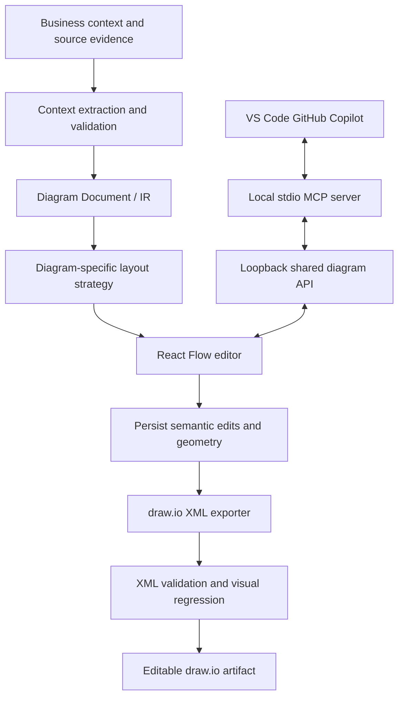
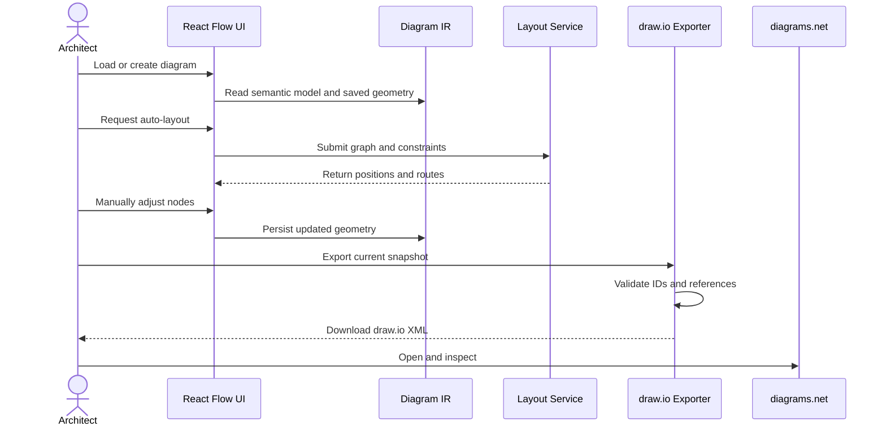
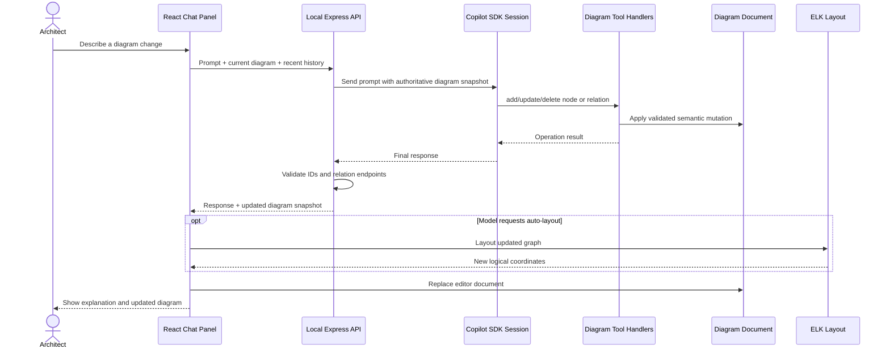
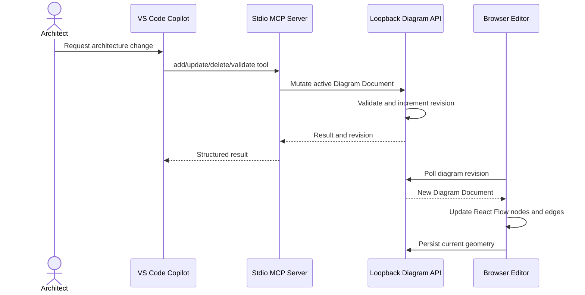

# Architecture

## Design principle
Treat the application as an architecture-diagram compiler with a visual editor. The versioned Diagram Document is the source of truth for semantics and logical layout.

## Component flow

## Runtime sequence

## Modules
- Context extraction converts requirements and source material into candidate entities and relations while preserving evidence and uncertainty.
- Diagram IR stores semantics, logical layout, styles, provenance, and schema version.
- Layout strategies use ELK layered layout for C4/dependency views and a dedicated constraint-based layout for sequence diagrams.
- React Flow adapter maps the IR to interactive nodes and edges and writes geometry changes back.
- draw.io exporter maps geometry, styles, containment, ports, and edge waypoints to mxGraph XML.
- Validation checks unique IDs and relationship references before export; unit tests cover model errors, geometry mapping, escaping, and deterministic output.
- Browser-local persistence stores the current diagram snapshot and geometry. A future project repository/import layer can replace the storage adapter without changing the diagram IR.

## Geometry fidelity
Use logical canvas coordinates rather than screen pixels multiplied by zoom. Convert React Flow node origins to draw.io top-left geometry. Save measured dimensions and manual edge waypoints. Never rerun layout during export.

Geometry mapping alone cannot guarantee pixel identity: text metrics, font availability, CSS/SVG features, shape primitives, and edge routers differ. Prefer native draw.io cells for editable architecture elements and use embedded SVG selectively.

## Layout policy
- Text or theme changes should not trigger full relayout unless dimensions materially change.
- Structural changes should trigger local layout where possible.
- Full layout is an explicit user action.
- Sequence ordering is a semantic invariant and must not be delegated to a generic graph layout algorithm.

## Copilot chat edit path

The browser never gives the model direct access to React Flow internals or the filesystem. The model receives the current versioned Diagram Document and can invoke only the diagram-specific tools registered by the local API. Tool handlers mutate a request-scoped semantic draft; validation runs before the draft is returned to the browser.

### Tool boundary

- The SDK client is long-lived; sessions are retained per browser chat ID in process memory.
- Session tools are limited to node CRUD, relation CRUD, title updates, and an explicit request for ELK layout. No shell, filesystem, or repository tools are registered.
- The browser sends the current diagram on each turn; it is authoritative over stale model context.
- Model edits are applied to a draft and validated before the API returns them. The browser applies the complete document snapshot, rather than trying to infer changes from natural-language text.
- If the API process restarts, the browser sends recent conversation history to seed a new SDK session. The runtime session itself is not durably resumed.
- The local API binds to loopback; do not expose it directly to a network without adding authentication and request authorization.

## VS Code Copilot MCP bridge

The local MCP server and browser editor share the active Diagram Document through the Express API. MCP tools perform validated semantic mutations against the API's active snapshot; the browser polls revision metadata and applies changes to React Flow. Browser edits and resulting geometry are sent back to the API so `get_current_diagram` observes the current canvas state.

The MCP server uses stdio for protocol traffic and keeps diagnostics on stderr. The API remains bound to `127.0.0.1`; this bridge is a local single-active-editor workflow, not a remote or multi-user collaboration service. See [VS Code Copilot MCP setup](vscode-copilot-mcp.md) and [ADR 0005](adr/0005-vscode-copilot-mcp.md).
