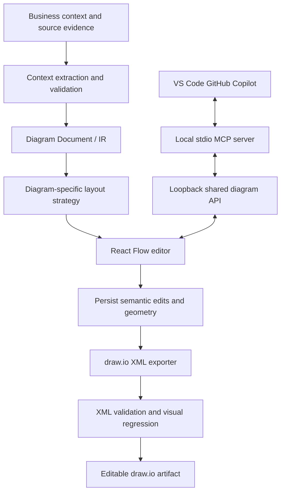
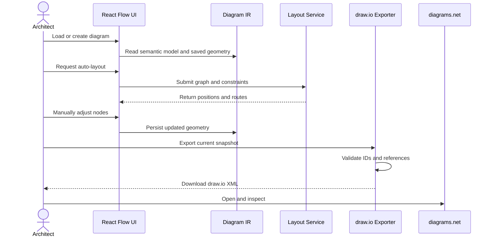
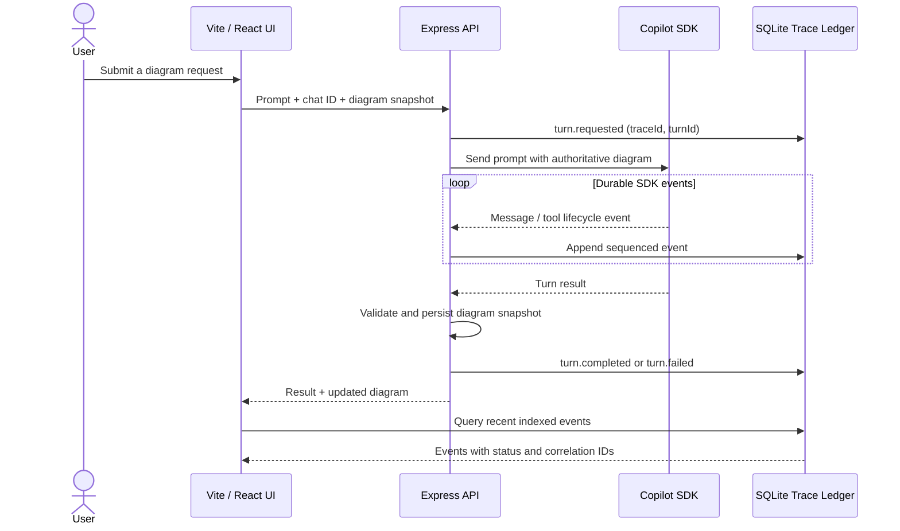
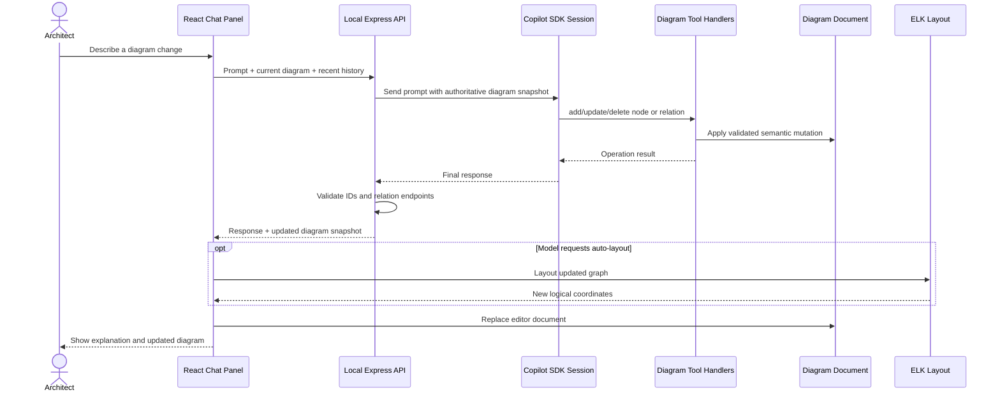
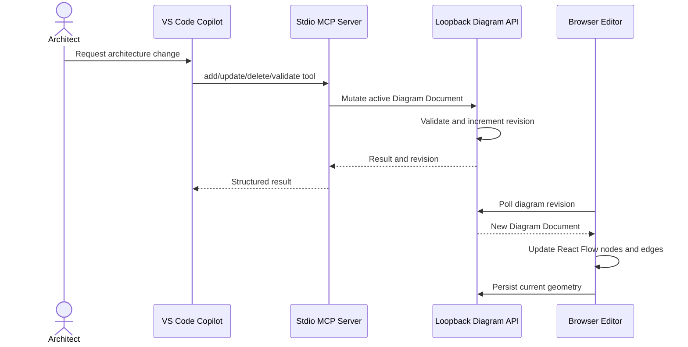
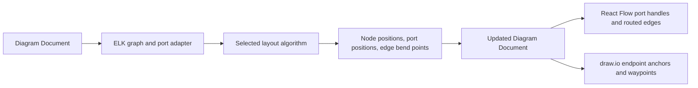

# Architecture

## Design principle
Treat the application as an architecture-diagram compiler with a visual editor. The versioned Diagram Document is the source of truth for semantics and logical layout.

## Component flow

## Runtime sequence

## Modules
- Context extraction converts requirements and source material into candidate entities and relations while preserving evidence and uncertainty.
- Diagram IR stores semantics, logical layout, styles, provenance, and schema version.
- Layout strategies use ELK layered layout for C4/dependency views and a dedicated constraint-based layout for sequence diagrams.
- React Flow adapter maps the IR to interactive nodes and edges and writes geometry changes back.
- draw.io exporter maps geometry, styles, containment, ports, and edge waypoints to mxGraph XML.
- Validation checks unique IDs and relationship references before export; unit tests cover model errors, geometry mapping, escaping, and deterministic output.
- The Express persistence adapter atomically stores the active diagram, revisions, and chat histories in a local state snapshot; an indexed SQLite ledger stores append-only agent execution events. Browser local storage remains a recovery cache. The runtime Copilot session object itself is not restored after process restart.

## Persistence and agent trace

The Express service persists the active diagram, revision metadata, and chat history to a local atomic JSON snapshot. Agent lifecycle and tool events are stored in an indexed SQLite audit ledger with trace/turn correlation, sequence, status, duration, and provider/model metadata. Legacy JSONL events are imported once; credential-shaped fields are redacted, and oversized payloads are explicitly marked incomplete. See [ADR 0006](adr/0006-local-persistence-and-agent-trace.md).

## Agent trajectory and audit lifecycle

Each turn uses a correlation ID, and every stored event has a monotonically assigned sequence within that trace. Credential-shaped fields are redacted before persistence. If an SDK event cannot be written, the API does not report that turn as successful. Payloads over the 1 MiB record limit are explicitly marked incomplete.

## Geometry fidelity
Use logical canvas coordinates rather than screen pixels multiplied by zoom. Convert React Flow node origins to draw.io top-left geometry. Save measured dimensions and manual edge waypoints. Never rerun layout during export.

Geometry mapping alone cannot guarantee pixel identity: text metrics, font availability, CSS/SVG features, shape primitives, and edge routers differ. Prefer native draw.io cells for editable architecture elements and use embedded SVG selectively.

## Layout policy
- Text or theme changes should not trigger full relayout unless dimensions materially change.
- Structural changes should trigger local layout where possible.
- Full layout is an explicit user action.
- Sequence ordering is a semantic invariant and must not be delegated to a generic graph layout algorithm.

## Copilot chat edit path

The browser never gives the model direct access to React Flow internals or the filesystem. The model receives the current versioned Diagram Document and can invoke only the diagram-specific tools registered by the local API. Tool handlers mutate a request-scoped semantic draft; validation runs before the draft is returned to the browser.

### Tool boundary

- The SDK client is long-lived; sessions are retained per browser chat ID in process memory.
- Session tools are limited to node CRUD, relation CRUD, title updates, and an explicit request for ELK layout. No shell, filesystem, or repository tools are registered.
- The browser sends the current diagram on each turn; it is authoritative over stale model context.
- Model edits are applied to a draft and validated before the API returns them. The browser applies the complete document snapshot, rather than trying to infer changes from natural-language text.
- If the API process restarts, the browser sends recent conversation history to seed a new SDK session. The runtime session itself is not durably resumed.
- The local API binds to loopback; do not expose it directly to a network without adding authentication and request authorization.

## VS Code Copilot MCP bridge

The local MCP server and browser editor share the active Diagram Document through the Express API. MCP tools perform validated semantic mutations against the API's active snapshot; the browser polls revision metadata and applies changes to React Flow. Browser edits and resulting geometry are sent back to the API so `get_current_diagram` observes the current canvas state.

The MCP server uses stdio for protocol traffic and keeps diagnostics on stderr. The API remains bound to `127.0.0.1`; this bridge is a local single-active-editor workflow, not a remote or multi-user collaboration service. See [VS Code Copilot MCP setup](vscode-copilot-mcp.md) and [ADR 0005](adr/0005-vscode-copilot-mcp.md).

## Layout capability matrix

| Engine / algorithm | Best fit | Direction / controls | Known constraints |
|---|---|---|---|
| ELK Layered (default) | C4, dependency and directed architecture graphs | Four directions; node/layer spacing; edge routing; ports; seed | Most architecture-oriented default; exact geometry differs from draw.io |
| ELK Mr. Tree | Rooted tree structures | Algorithm-specific support for direction/ports | Tree assumption may be a poor fit for dense cyclic graphs |
| ELK Radial | Hub-and-spoke / central system diagrams | Radial arrangement; selected options may be ignored | Not a substitute for layered dependency order |
| ELK Stress | General relationship maps | Stress iteration limit and supported graph options | Optimizes a different visual objective than layer ordering |
| ELK Force | Force-directed arrangement | Iterations, seed, and supported force options | May not preserve a directional architecture narrative |
| Dagre | Fast directed graphs | LR / RL / TB / BT, node spacing, rank spacing, margin | Simpler constraints than ELK; no layout-generated port routing in this adapter |
| D3 Hierarchy | Trees and forests | Four directions, sibling/layer/component spacing | Uses a spanning forest; cross-links do not affect placement |
| D3 Force | Connected / exploratory graph | Link distance and strength, repulsion, collision, fixed tick budget | One-shot bounded simulation; not continuous physics |

ELK options use the engine's supported option set. A common settings panel does not mean every option applies to every ELK algorithm. The UI keeps direction near Auto Layout and detailed settings in the Advanced dialog. Layout selection only changes configuration; Auto Layout is the explicit geometry-changing action.

## Port and route data flow

The Diagram Document remains authoritative. React Flow nodes and edges are projections for interaction, and structural canvas changes must be applied to the document before persistence/export. Optional port fields are backward compatible with saved schema-version-1 diagrams. The exporter consumes saved geometry and does not rerun layout. Theme colors and node treatments are editor-only presets; draw.io has its own explicit style mapping.

## Architecture review findings

| Priority | Finding | Treatment |
|---|---|---|
| High | Canvas state and semantic Diagram Document are duplicated; deletion must update both representations | Canvas removal handlers now synchronize semantic nodes/relations and clear dependent geometry |
| High | Layout settings previously did not control the rendered route, and ports were not represented in the IR | Port metadata and edge waypoints now cross the layout, React Flow, persistence, and draw.io adapter boundaries; regression tests cover layout variants and exported anchors |
| Medium | App.tsx still coordinates editor, persistence sync, settings, chat, and trace presentation | Keep the current change bounded; split the canvas adapter and settings components in a later focused refactor |
| Medium | Browser-to-API revision polling and Copilot sessions are single-editor/process-oriented, not collaboration-safe | Keep the API loopback-only; use optimistic revision checks; do not advertise multi-user consistency |
| Medium | Persisted JSON is versioned but only the envelope is checked at load time | Deep schema validation/migrations for the persisted diagram remain a hardening item |
| Medium | No automated visual round-trip proves identical React Flow and draw.io rendering | Test semantic geometry and inspect exported files; pixel identity is not guaranteed across renderers |

## Layout and presentation policy

- Text edits and theme changes do not trigger a full layout unless a geometry-affecting dimension change is explicitly requested.
- Structural changes are reflected in the Diagram Document before a save or export.
- Full layout remains user-triggered. Export never invokes a layout algorithm.
- Sequence participant order and message timing are semantic invariants and need a dedicated sequence layout strategy.

## React Flow / draw.io renderer parity contract

The Diagram Document is the rendering contract for both adapters. `src/model/routing.ts` normalizes old diagrams by deriving stable source/target handle IDs, storing local port positions, and computing deterministic orthogonal bend points without moving nodes. ELK's returned ports and bend points take precedence; Dagre, D3 Hierarchy, and D3 Force use the same fallback router when they do not supply routes. A manual node move invalidates routes touching that node so the editor and next export derive new points from the moved endpoints.

React Flow must use the port IDs and route stored in each relation rather than run an unrelated edge router. Its HTML edge labels are overlaid at the route midpoint; connection handles remain interactive but transparent until hover/selection. Person and database node renderers use dedicated SVG silhouettes matching the native draw.io UML actor and cylinder shapes. Node title and technology use the same size/weight/color hierarchy in both renderers.

The draw.io exporter uses matching logical bounds, HTML title/subtitle labels, `exitX` / `exitY` / `entryX` / `entryY` anchors, and explicit `<mxPoint>` bend points. For a routed edge it uses `edgeStyle=none` so mxGraph does not independently recalculate the geometry. The exporter may normalize missing ports/routes in a temporary copy of an older document, but it never mutates the saved document, moves nodes, or invokes an auto-layout engine.

The editor background uses two line-grid layers to approximate diagrams.net's minor and major grid. The renderer contract aims for visual equivalence at the same logical zoom and geometry; pixel identity is still subject to browser/Java font metrics and needs a rendered browser-to-diagrams.net integration test.
