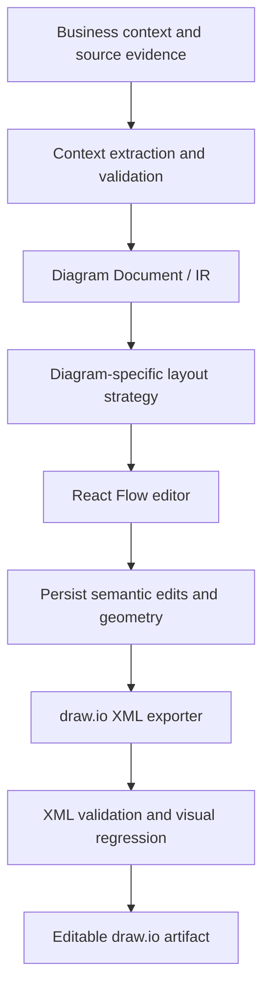
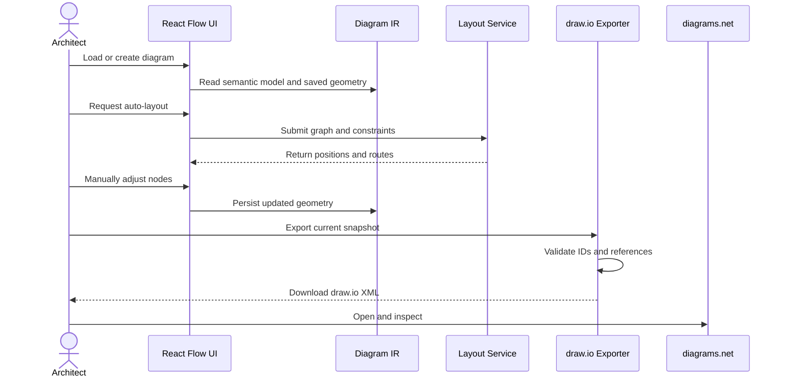

# Architecture

## Design principle
Treat the application as an architecture-diagram compiler with a visual editor. The versioned Diagram Document is the source of truth for semantics and logical layout.

## Component flow

## Runtime sequence

## Modules
- Context extraction converts requirements and source material into candidate entities and relations while preserving evidence and uncertainty.
- Diagram IR stores semantics, logical layout, styles, provenance, and schema version.
- Layout strategies use ELK layered layout for C4/dependency views and a dedicated constraint-based layout for sequence diagrams.
- React Flow adapter maps the IR to interactive nodes and edges and writes geometry changes back.
- draw.io exporter maps geometry, styles, containment, ports, and edge waypoints to mxGraph XML.
- Validation checks referential integrity, graph invariants, XML parseability, and visual regressions.

## Geometry fidelity
Use logical canvas coordinates rather than screen pixels multiplied by zoom. Convert React Flow node origins to draw.io top-left geometry. Save measured dimensions and manual edge waypoints. Never rerun layout during export.

Geometry mapping alone cannot guarantee pixel identity: text metrics, font availability, CSS/SVG features, shape primitives, and edge routers differ. Prefer native draw.io cells for editable architecture elements and use embedded SVG selectively.

## Layout policy
- Text or theme changes should not trigger full relayout unless dimensions materially change.
- Structural changes should trigger local layout where possible.
- Full layout is an explicit user action.
- Sequence ordering is a semantic invariant and must not be delegated to a generic graph layout algorithm.