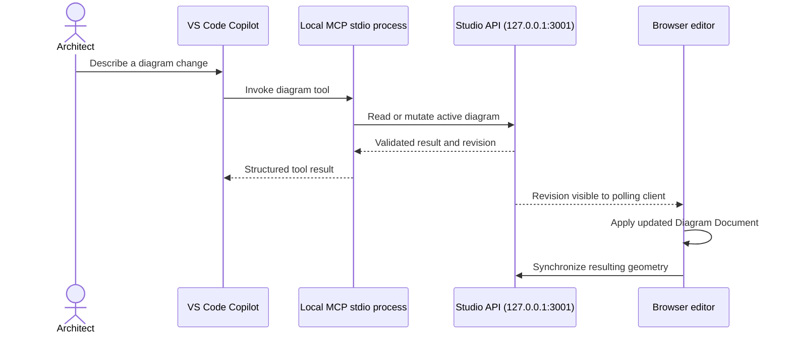

# VS Code Copilot MCP integration

Architecture Diagram Studio exposes its active diagram through a local stdio MCP server. VS Code Copilot can inspect and edit the same diagram shown in the browser; the browser synchronizes with the Studio API on loopback.

## Requirements and startup

- Node.js 22.13+ and npm.
- Install dependencies with `npm install`.
- Authenticate the existing Copilot SDK runtime as described in the root README.
- Start the Studio with `npm run dev` and open the editor in a browser. Keep it open while using the MCP tools.

The repository includes `.vscode/mcp.json`, which launches the server directly with `node --import tsx server/mcp.ts` (rather than through `npm run`, whose banner would interfere with stdio protocol output). After installing dependencies, reload VS Code or run **MCP: List Servers**, then start/restart **architecture-diagram-studio** if necessary. Choose the Local or Copilot agent experience that supports workspace MCP servers and approve the server when prompted.

The MCP process uses stdio for protocol messages. Do not add console output to stdout in `server/mcp.ts`; diagnostics must go to stderr. It calls the Studio API at `http://127.0.0.1:3001`. Override that address with `ARCHITECTURE_DIAGRAM_API` only if the local API is intentionally configured elsewhere.

## Available tools

| Tool | Purpose |
|---|---|
| `get_current_diagram` | Read the active diagram, including node/relation IDs and geometry |
| `add_diagram_node` | Add a typed node |
| `update_diagram_node` | Change node type, label, description, or technology |
| `delete_diagram_node` | Remove a node and its connected relationships |
| `add_diagram_relation` | Add a labeled relationship between existing nodes |
| `update_diagram_relation` | Change relationship label or kind |
| `delete_diagram_relation` | Remove a relationship |
| `set_diagram_title` | Rename the diagram |
| `validate_diagram` | Run semantic validation without changing the model |
| `request_diagram_auto_layout` | Ask the open browser editor to apply its selected layout engine |

## Interaction model

The Studio API validates IDs and relationship endpoints before accepting mutations. The browser polls for revisions every second and synchronizes geometry changes back to the API. The API stores the shared active diagram in process memory; it is not a durable project repository. On API restart, the open browser seeds the active diagram from its local persisted snapshot.

## Security and limitations

- The MCP server runs local code and should be reviewed like any other workspace MCP configuration.
- The Studio API binds to loopback and does not expose a remote listener. Do not expose it to a LAN without authentication, authorization, and origin protections.
- The MCP server requires the Studio API and an open browser editor to be running; it intentionally does not silently edit a separate file or an unrelated diagram.
- Shared state is a single active diagram per local Studio process. Multiple independent browser tabs are not a collaborative multi-user editing system; avoid concurrent editing from multiple tabs.
- The MCP tools do not expose shell, filesystem, repository, or arbitrary HTTP access to Copilot. A2A is not required for this local tool-invocation workflow.
